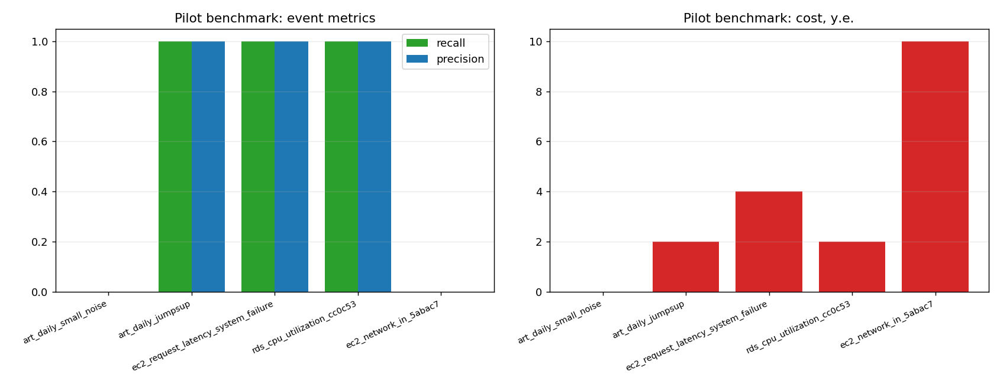
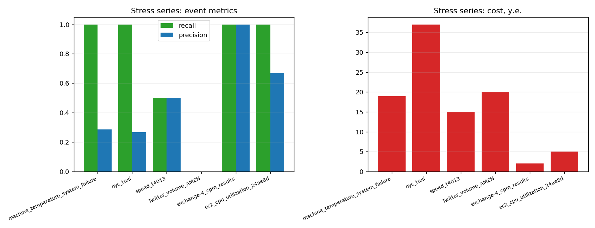
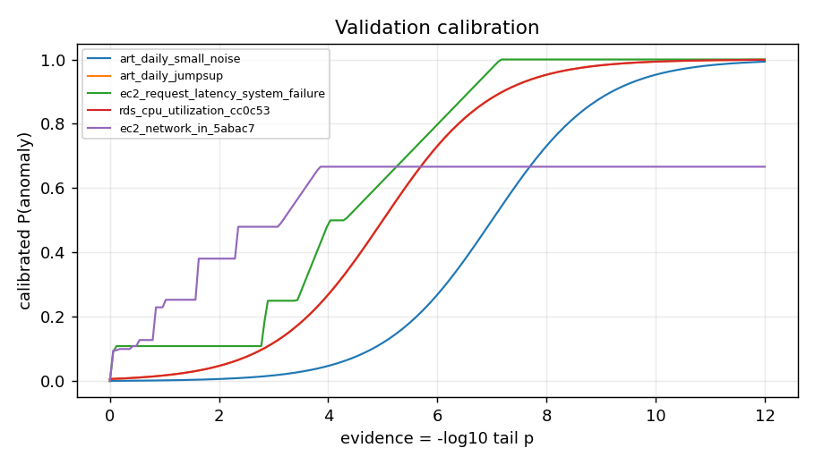

# NAB Anomaly Detection System — Final Report

Stages 2–4: data audit, split, baseline, combined detector, action policy, quality evaluation and service demonstration.

## 1. Data audit

| series | regular_rows | step_seconds | gap_count | max_gap_seconds | imputed_values | daily_acf | label_windows | label_positive_points |
|---|---|---|---|---|---|---|---|---|
| art_daily_small_noise | 4032 | 300 | 0 | 0.000 | 0 | 0.750 | 0 | 0 |
| art_daily_jumpsup | 4032 | 300 | 0 | 0.000 | 0 | 0.748 | 1 | 403 |
| ec2_request_latency_system_failure | 4033 | 300 | 2 | 3840.000 | 7 | 0.000 | 3 | 346 |
| rds_cpu_utilization_cc0c53 | 4033 | 300 | 1 | 600.000 | 1 | 0.174 | 2 | 403 |
| ec2_network_in_5abac7 | 4730 | 300 | 1 | 3840.000 | 6 | 0.034 | 2 | 474 |
| machine_temperature_system_failure | 22683 | 300 | 0 | 0.000 | 0 | 0.208 | 4 | 2268 |
| nyc_taxi | 10320 | 1800 | 0 | 0.000 | 0 | 0.831 | 5 | 1035 |
| speed_t4013 | 4667 | 300 | 545 | 303660.000 | 241 | 0.000 | 2 | 307 |
| Twitter_volume_AMZN | 15831 | 300 | 0 | 0.000 | 0 | 0.159 | 4 | 1580 |
| exchange-4_cpm_results | 1647 | 3600 | 4 | 7200.000 | 4 | 0.034 | 4 | 166 |
| ec2_cpu_utilization_24ae8d | 4032 | 300 | 0 | 0.000 | 0 | 0.237 | 2 | 402 |

Full audit: `reports/data_audit.md`, `reports/data_audit.json`. Missing short gaps are linearly interpolated (≤ 6 points); longer gaps are kept as NaN and are not used for fitting.

## 2. Split and detector

Split: train/validation/test = 30%/30%/40%. The train split excludes labelled windows and a warm-up prefix. The validation split is used only for probability calibration.

Detector: five causal robust-z features (`z_short`, `z_long`, `z_diff`, `z_seas`, `z_level`) with global MAD floors; per-feature peaks-over-threshold GPD tail models (q=0.95); evidence = max(-log10 p). `WARNING` requires `k=2` consecutive points above the warning threshold; episodes end after 48 quiet points and use a 0.6 hysteresis exit. Critical evidence creates `INCIDENT` immediately; otherwise `WARNING` is sent first and one later `INCIDENT` escalation is allowed. Each alert type is sent at most once per episode.

### Criticality-aware evidence thresholds

| criticality | warning | incident |
|---|---|---|
| 1 | 7.000 | 9.000 |
| 2 | 6.000 | 8.000 |
| 3 | 5.000 | 7.000 |
| 4 | 4.500 | 6.500 |
| 5 | 4.000 | 6.000 |

The passport's theoretical cost thresholds (p=0.14 / 0.50) are converted to operational evidence thresholds and then to calibrated probabilities per series. The probability columns below show the resulting per-series operating points.

| series | calibration | e_warning | e_incident | p_warning | p_incident |
|---|---|---|---|---|---|
| art_daily_small_noise | fallback | 7.000 | 9.000 | 0.500 | 0.881 |
| art_daily_jumpsup | fallback | 5.000 | 7.000 | 0.500 | 0.881 |
| ec2_request_latency_system_failure | isotonic | 4.500 | 6.500 | 0.535 | 0.885 |
| rds_cpu_utilization_cc0c53 | fallback | 5.000 | 7.000 | 0.500 | 0.881 |
| ec2_network_in_5abac7 | isotonic | 5.000 | 7.000 | 0.667 | 0.767 |

## 3. Stage-2 baseline vs combined detector

Rolling-z baseline: recall=1.000, precision=0.231, cost=72.0 у.е. Combined detector: recall=0.833, precision=1.000, cost=18.0 у.е.

| series | crit | windows | TP | FP | FN | recall | precision | fp/24h | latency_obs | cost | baseline_recall | baseline_precision | baseline_cost |
|---|---|---|---|---|---|---|---|---|---|---|---|---|---|
| art_daily_small_noise | 1 | 0 | 0 | 0 | 0 | 0.000 | 0.000 | 0.000 | 0.000 | 0.000 | 0.000 | 0.000 | 18.000 |
| art_daily_jumpsup | 3 | 1 | 1 | 0 | 0 | 1.000 | 1.000 | 0.000 | 0.000 | 2.000 | 1.000 | 0.200 | 14.000 |
| ec2_request_latency_system_failure | 4 | 2 | 2 | 0 | 0 | 1.000 | 1.000 | 0.000 | 0.000 | 4.000 | 1.000 | 1.000 | 4.000 |
| rds_cpu_utilization_cc0c53 | 3 | 2 | 2 | 0 | 0 | 1.000 | 1.000 | 0.000 | 0.000 | 2.000 | 1.000 | 0.667 | 7.000 |
| ec2_network_in_5abac7 | 3 | 1 | 0 | 0 | 1 | 0.000 | 0.000 | 0.000 | 0.000 | 10.000 | 1.000 | 0.100 | 29.000 |

First-line checks (`check_results`): 36 alerts checked automatically for the pilot history, 13 confirmed as real faults, 23 false alarms. Historical confirmed alerts are marked `ACKNOWLEDGED` (diagnostics/closure pending), false alarms are `CLOSED`; new manual alerts start as `OPEN` and use the interactive duty-engineer workflow.

## 4. Success criteria

| criterion | status | value |
|---|---|---|
| Recall ≥ 0.80 | PASS | 0.833 |
| Precision ≥ 0.70 | PASS | 1.000 |
| FP ≤ 2 / series / 24h | PASS | worst 0.000 |
| p95 decision latency < 1 s | PASS | 1.0 ms |

Event-level metrics use whole episodes: one long episode may cover several label windows, so warning+incident of the same episode are not counted as separate FP. Latency is measured from the raw NAB onset to the first alert of the episode.



## 5. Stress series (separate report)

These series are deliberately non-stationary or have very wide contextual labels. They are not part of the pilot success criteria; the table documents the degradation.

| series | crit | windows | TP | FP | FN | recall | precision | fp/24h | latency_obs | cost | baseline_recall | baseline_precision | baseline_cost |
|---|---|---|---|---|---|---|---|---|---|---|---|---|---|
| machine_temperature_system_failure | 5 | 2 | 2 | 5 | 0 | 1.000 | 0.286 | 0.159 | 0.000 | 19.000 | 0.500 | 0.333 | 18.000 |
| nyc_taxi | 3 | 4 | 4 | 11 | 0 | 1.000 | 0.267 | 0.128 | 0.000 | 37.000 | 1.000 | 1.000 | 2.000 |
| speed_t4013 | 4 | 2 | 1 | 1 | 1 | 0.500 | 0.500 | 0.154 | 0.000 | 15.000 | 0.500 | 1.000 | 12.000 |
| Twitter_volume_AMZN | 2 | 2 | 0 | 0 | 2 | 0.000 | 0.000 | 0.000 | 0.000 | 20.000 | 1.000 | 0.182 | 29.000 |
| exchange-4_cpm_results | 2 | 2 | 2 | 0 | 0 | 1.000 | 1.000 | 0.000 | 0.000 | 2.000 | 1.000 | 1.000 | 2.000 |
| ec2_cpu_utilization_24ae8d | 3 | 2 | 2 | 1 | 0 | 1.000 | 0.667 | 0.179 | 0.000 | 5.000 | 1.000 | 1.000 | 2.000 |

Stress aggregate: recall=0.786, precision=0.379, cost=98.0 у.е.



## 6. Service demo

Replay around the first test failure of `ec2_request_latency_system_failure`. The demo shows normal operation, immediate `INCIDENT` at the first critical point, and recovery after the episode closes. Full log: `reports/demo_log.txt`.

```
failure start: 2014-03-18 22:36:00
recovery start: 2014-03-19 02:46:00
2014-03-18 22:36          65.68      9.73  1.000  INCIDENT  failure
actions: {'SKIP': 120, 'INCIDENT': 1}
```



## 7. Web dashboard and deployment

The FastAPI app also serves a server-rendered dashboard (`/`) with a chart per series, latest alerts, operational KPIs, quality statistics and manual point entry. Sessions use signed HttpOnly cookies; passwords use PBKDF2-HMAC-SHA256. Two demo roles are seeded: the duty engineer (`operator`) and the administrator (`admin`). `/observe` and manual point entry require the administrator; the alert workflow requires the duty engineer. The dashboard refreshes KPIs, alerts and statistics every 10 s, and the chart every 30 s; manual points update it immediately. Docker Compose runs PostgreSQL, the app and nginx; the app waits for the database and can run the full pipeline on first start.

The alert workflow implements the supplied processing scheme: data-quality and `min_history` gates, anomaly score, immediate `INCIDENT` for critical evidence, otherwise `WARNING` after `k=2` with one later `INCIDENT` escalation, status `OPEN` with episode context, duty-engineer check (`is_real_fault`), confirmation/diagnostics or false-alarm closure, operational statistics, and journal entries for decisions/checks. Operators can use `POST /alerts/{id}/ack`, `/check` and `/close` or the dashboard buttons. The scheme’s contradictory arrows (both “выраженное” and “устойчивое” deviation point to `INCIDENT`) are resolved by the critical-evidence rule above; the web workflow is independent of that policy choice.

## 8. Reproduce

```bash
source .venv/bin/activate
python -m nab_system.cli init-db
python -m nab_system.cli audit
python -m nab_system.cli pipeline
python -m nab_system.cli demo
python -m nab_system.cli report
python -m nab_system.cli serve --port 8000
pytest -q
docker compose up --build  # dashboard at http://127.0.0.1:8081
```
